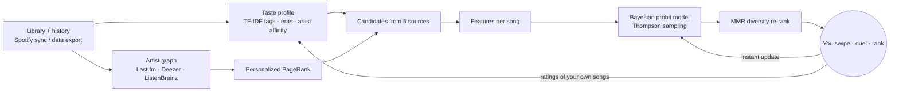

<div align="center">


# Spoter

**Spotify × Tinder. Swipe, duel and rank songs until the algorithm knows your taste better than you do.**

[](https://github.com/BurgiSimon/spoter/actions/workflows/ci.yml)
[](LICENSE)

</div>

Spoter imports your Spotify library and listening history, builds a model of your music taste, and
recommends new songs. Every interaction refines that model: swiping on a preview, picking the
better of two songs, or dragging five of your own favourites into order.

## Features

- **Import everything.** Connect Spotify (liked songs, your playlists, top tracks and artists over
  three time ranges, recent plays, followed artists), or upload your **Spotify data export** to
  use years of listening history. The export is parsed in your browser; only song names, IDs and
  play timestamps are uploaded.
- **Discover (swipe).** 30-second previews on a Tinder-style deck. Right = like, left = pass,
  up = super like (it goes straight to a private "Spoter Discoveries" playlist on Spotify),
  down = not now. Undo restores the model exactly.
- **Duel (this or that).** Two songs, pick the better one. Spoter chooses the pairs it is
  _least sure about_ (active learning), mixing new songs and songs you already know.
- **Rank.** Drag five songs from your library into order. Each ranking is ten pairwise
  comparisons and separates songs you _love_ from songs you just play a lot.
- **For you.** Your current best matches with confidence scores and human-readable reasons
  ("Fans of Slowdive listen to this", "Matches your taste in dream pop, shoegaze").
- **Your taste.** Your characteristic tags, eras and core artists, what your feedback taught the
  model, plus knobs for adventurousness, mainstream vs. underground, explicit content, blocked
  tags and blocked artists.
- **Yours to keep.** One-click JSON export of everything stored about you, and permanent account
  deletion.

## How the recommendations work

Spotify removed its recommendations, audio-features and related-artists endpoints for new apps in
November 2024, so Spoter builds its own engine from open data. The full write-up, with the math,
is in [docs/ALGORITHM.md](docs/ALGORITHM.md). In short:



1. **Taste profile.** Every library song gets a weight from play count (diminishing returns),
   recency, saves, playlists, top-track ranks and skips. Those weights build a TF-IDF tag vector,
   so distinctive tags like _shoegaze_ outweigh generic ones like _rock_, plus an era histogram
   and artist affinities.
2. **Artist graph.** Similar-artist edges from Last.fm, Deezer and ListenBrainz. A
   _personalized PageRank_ seeded with your artists finds artists close to many of your
   favourites at once, including second- and third-degree neighbours.
3. **Candidates** come from five independent sources: similar tracks of your most-loved songs,
   top tracks of graph neighbours, deeper cuts from artists you know, chart toppers of your
   characteristic tags, and artist radio.
4. **Scoring.** Each candidate gets a sparse feature vector: tag similarity, graph proximity,
   track similarity, source consensus, era and popularity fit, novelty, plus tag, artist, decade
   and tempo indicators. An online **Bayesian probit regression** (AdPredictor-style) holds a
   Gaussian belief for every weight. Swipes are probit updates and duels are updates on the
   _difference_ of two feature vectors (the Thurstone model of paired comparisons), so every
   method trains the same model, instantly, with calibrated uncertainty.
5. **Exploration.** Discover uses **Thompson sampling** (one draw from the posterior per batch),
   so uncertain songs get a fair chance, and **MMR re-ranking** keeps batches diverse (one song
   per artist, varied tags). Duels pick pairs by expected information gain.
6. **Your own songs** carry **TrueSkill-style ratings** updated by duels and rankings. A song
   you rank highly gets more weight in your taste profile than one you merely loop.

## Quick start (Docker)

You need Docker and a domain with HTTPS for production. Spotify requires HTTPS redirect URIs
except on loopback.

```bash
git clone https://github.com/BurgiSimon/spoter.git && cd spoter
cp .env.example .env
# Fill in at least ENCRYPTION_KEY (openssl rand -base64 32), POSTGRES_PASSWORD and APP_URL.
docker compose up -d --build
```

Compose starts Postgres, runs migrations once, then starts the **web** app (port 3000) and the
**worker** (background sync, enrichment and candidate generation). Put a TLS-terminating reverse
proxy in front of port 3000. With [Caddy](https://caddyserver.com/) that is one line:

```
spoter.example.com {
  reverse_proxy 127.0.0.1:3000
}
```

Tagged releases also publish an image: `ghcr.io/burgisimon/spoter:<version>`.

## Configuration

| Variable                                      | Required    | Description                                                                                                          |
| --------------------------------------------- | ----------- | -------------------------------------------------------------------------------------------------------------------- |
| `APP_URL`                                     | yes         | Public URL, e.g. `https://spoter.example.com` (locally `http://127.0.0.1:3000`).                                     |
| `ENCRYPTION_KEY`                              | yes         | 32 random bytes, base64. Encrypts Spotify tokens and signs OAuth state.                                              |
| `DATABASE_URL`                                | yes         | Postgres 14+ connection string (Compose builds it from `POSTGRES_PASSWORD`).                                         |
| `LASTFM_API_KEY`                              | recommended | Free key from [last.fm/api](https://www.last.fm/api/account/create). Adds track tags, similar tracks and tag charts. |
| `SPOTIFY_CLIENT_ID` / `SPOTIFY_CLIENT_SECRET` | optional    | Enables "Continue with Spotify", library sync and playlist export.                                                   |
| `ALLOW_REGISTRATION`                          | no          | `false` disables new email sign-ups. Default `true`.                                                                 |
| `WORKER_CONCURRENCY`                          | no          | Parallel per-user pipelines per worker process. Default `2`.                                                         |
| `SOURCE_URL`                                  | no          | Where users get this instance's source (AGPL §13). Change it if you modify Spoter.                                   |
| `LOG_LEVEL`                                   | no          | `info` by default.                                                                                                   |

Without Last.fm, Spoter falls back to MusicBrainz community tags, ListenBrainz similar artists
and Deezer. That works well, but Last.fm adds the most precise track-level signals.

### Setting up the Spotify app

1. Create an app in the [Spotify Developer Dashboard](https://developer.spotify.com/dashboard)
   and select **Web API**.
2. Add the redirect URI `<APP_URL>/api/auth/spotify/callback`, for example
   `http://127.0.0.1:3000/api/auth/spotify/callback` locally. Spotify rejects `localhost`.
3. Copy the client ID and secret into `.env`.

**Know the limits (2026).** New apps run in _Development Mode_: the app owner needs Spotify
Premium, and at most **5 users** you allow-list under _User Management_ can connect. Extended
quota is only granted to organisations with 250k+ monthly active users. Spoter is built around
this: anyone can create an email account and upload their **Spotify data export** instead, which
holds far more history than the API anyway.

To get your export, go to [spotify.com/account/privacy](https://www.spotify.com/account/privacy/)
and request **Extended streaming history** (all years, up to 30 days) and/or **Account data**
(last year plus library and playlists, about 5 days). Then drop the zip on Spoter's _Import_
page.

## Local development

Requirements: Node 22.12+, pnpm 10 (`corepack enable`), and Docker Desktop for the database (or
any Postgres 14+).

```bash
pnpm install
pnpm dev:setup      # creates .env, starts Postgres on 127.0.0.1:5433, runs migrations
pnpm dev:all        # web (http://127.0.0.1:3000) + background worker, with hot reload
pnpm demo:export    # optional: sample Spotify export to upload on the Import page
```

Step-by-step instructions, including setting up the Spotify app and Last.fm key for local use,
plus troubleshooting, are in **[docs/LOCAL_DEVELOPMENT.md](docs/LOCAL_DEVELOPMENT.md)**.

| Command                        | What it does                                                                   |
| ------------------------------ | ------------------------------------------------------------------------------ |
| `pnpm lint` / `pnpm typecheck` | ESLint and TypeScript                                                          |
| `pnpm test`                    | Unit tests; set `TEST_DATABASE_URL` to also run the Postgres integration tests |
| `pnpm build`                   | Production build (web + worker bundle)                                         |
| `pnpm db:generate`             | New SQL migration after editing `src/lib/db/schema.ts`                         |

### Project layout

```
src/
  app/                 Next.js 16 App Router: pages and API route handlers
  components/          UI (swipe deck, duel, ranking, charts…)
  lib/
    engine/            the recommendation engine: pure, unit-tested functions
    pipeline/          worker steps: sync, ingest, enrich, profile, candidates
    providers/         Deezer, Last.fm, MusicBrainz, ListenBrainz clients (rate-limited, cached)
    spotify/           OAuth, API client, playlist export
    import/            in-browser Spotify export parser (+ Web Worker)
    auth/              argon2id passwords, DB sessions, rate limiting
    db/                Drizzle schema and client
  worker/              background worker entry (pg-boss)
drizzle/               SQL migrations
tests/                 Vitest unit + integration tests
```

**Stack:** Next.js 16 (Cache Components), React 19, TypeScript, Tailwind CSS 4, Motion,
PostgreSQL with Drizzle ORM, pg-boss for jobs, Vitest.

## Security and privacy

- Passwords hashed with argon2id. Sessions are random tokens stored as SHA-256 hashes, in
  `HttpOnly`, `SameSite=Lax` cookies.
- Spotify access and refresh tokens are encrypted at rest (AES-256-GCM).
- Cookie-authenticated mutations require a same-origin `Origin` header. A strict CSP and
  security headers are set on every response.
- Auth, import, export and refresh endpoints are rate limited in Postgres, so this works across
  instances.
- Data exports are parsed client-side. IP addresses, devices and emails in the export never leave
  the browser.
- Users can download or permanently delete all their data from _Settings_.

Found a vulnerability? See [SECURITY.md](SECURITY.md).

## License

Spoter is free software under the **GNU Affero General Public License v3.0**, see
[LICENSE](LICENSE). You may use, study, modify and self-host it. If you run a modified version as
a network service, you must offer its complete source code to its users under the same license.
Closed-source clones are not allowed.

The **Spoter name and logo** are not covered by the AGPL. Public forks must use their own name
and branding, see [TRADEMARKS.md](TRADEMARKS.md).

Spoter is not affiliated with Spotify, Tinder, Deezer, Last.fm or MetaBrainz. Previews are
provided by Deezer and metadata by Last.fm, MusicBrainz and ListenBrainz under their respective
terms.
